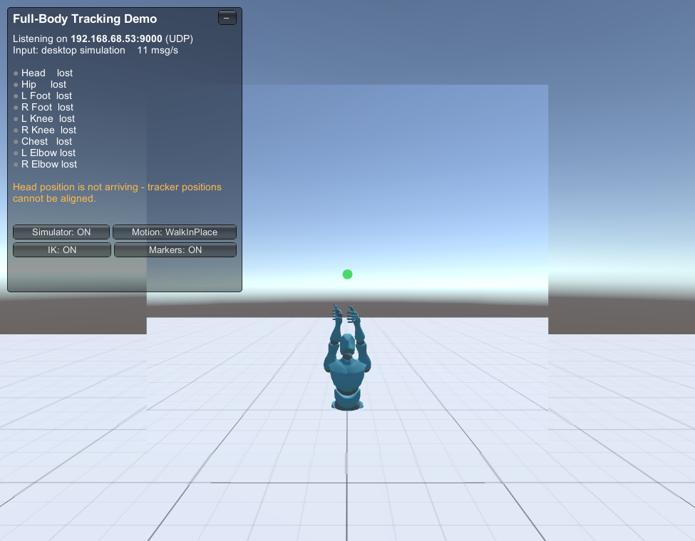

# VR Full-Body Tracking over OSC

Drive a humanoid avatar with full-body tracking in Unity. Tracker data arrives over **OSC** using the
[VRChat OSC Trackers](https://docs.vrchat.com/docs/osc-trackers) protocol, is decoded with
[OscCore](https://github.com/vrchat/OscCore), and is applied with Unity's built-in **Animator IK**.
No paid IK package is needed.



Press Play and the demo runs by itself: a built-in simulator streams real OSC messages to the app, so you can
see the whole pipeline work before connecting any hardware.

## Requirements

| | |
|---|---|
| Unity | 2022.3.62f2 (URP 14.0.12) |
| Packages | XR Interaction Toolkit 3.1.2, OpenXR 1.14.3, Input System 1.14.0, TextMeshPro (all in `Packages/manifest.json`) |
| Bundled | [OscCore](https://github.com/vrchat/OscCore) in `Assets/OscCore-1.1.7` (MIT) |
| Hardware (optional) | An XR headset, plus any tracker app that can send VRChat-style OSC trackers (for example SlimeVR's VRChat OSC output) |

## Quick start (no hardware)

1. Open the project in Unity and load `Assets/FullBodyTracking/Demo/FBT_Demo.unity`.
2. Press **Play**.
3. After about a second the scene switches to *desktop simulation*. The avatar walks in place and a mirror shows it from the front.
4. Use the panel at the top left to try things:
   - **Simulator** toggles the OSC stream on and off. Trackers time out and the avatar falls back to its animation pose.
   - **Motion** cycles Idle, WalkInPlace and Squat.
   - **IK** turns the IK on and off.
   - **Markers** shows or hides the coloured tracker spheres (blue is left, orange is right, green is centre).

The panel also shows the address the app is listening on (for example `192.168.1.23:9000`). That is the address your tracker sender must target.

## Using real trackers

1. Start the demo (editor or an Android/Quest build). With a headset connected the scene switches to XR mode on its own,
   the simulator goes quiet, and a status label appears in the world.
2. Point your tracker app's OSC output at the IP and port shown in the status panel. The default port is **9000**.
   On the same PC use `127.0.0.1`.
3. The app expects this tracker numbering. Make your sender match it:

| OSC address | Body part |
|---|---|
| `/tracking/trackers/head/position` and `/rotation` | Head (used to align tracker space, see below) |
| `/tracking/trackers/1/...` | Hip |
| `/tracking/trackers/2/...` | Left foot |
| `/tracking/trackers/3/...` | Right foot |
| `/tracking/trackers/4/...` | Left knee |
| `/tracking/trackers/5/...` | Right knee |
| `/tracking/trackers/6/...` | Chest |
| `/tracking/trackers/7/...` | Left elbow |
| `/tracking/trackers/8/...` | Right elbow |

Each address carries three floats: position in metres, or rotation as Euler angles in degrees, in Unity's coordinate system (+Y up).
Hands come from the XR controllers and the head from the headset. Missing trackers are simply skipped.

**Port already in use?** VRChat itself listens on 9000. If VRChat runs on the same PC, pick another port
(`Listen Port` on the controller, and the same port in your sender). The status panel shows a red message when the port could not be opened.
**Nothing arriving?** Allow Unity (or your build) through the Windows firewall for UDP, and make sure the device and the sender are on the same network.

### How positions are aligned

`Tracking Alignment` on the controller has two modes:

- **HeadRelative** (default): each tracker is placed at `headset position + (tracker − OSC head position)`. This is what lets
  the sender's origin be anywhere. It requires the sender to also stream the head position.
- **Absolute**: OSC positions are used as Unity world positions directly.

## Project layout

```
Assets/
  FullBodyTracking/
    Scripts/        OscFullBodyIKController, OscTrackerSimulator, TrackerStatusHud, FbtDemoManager
    Prefabs/        FBT_Avatar_YBot  (avatar + tracker targets, already wired)
    Characters/     Y Bot, animator controller, materials
    Demo/           FBT_Demo.unity and its materials
    Experimental/   FinalIK_VRIK_Test.unity (optional, needs Final IK)
  OscCore-1.1.7/    OSC library (third party, MIT)
  Plugins/Android/  AndroidManifest for Quest builds
  Samples, VRTemplateAssets, XR, XRI, Settings   Unity XR template content and settings
Docs/               README images
```

## How it works

```
tracker app --UDP/OSC--> OscServer (OscCore) --> OscFullBodyIKController --> Animator IK --> avatar
                                                        ^
                                         headset + controllers (XR rig or simulated)
```

- **`OscFullBodyIKController`** sits on the avatar. It registers the OSC addresses, keeps the latest values per tracker
  (thread-safe, since OscCore delivers on its own thread), converts them to world-space targets, and applies
  them in `OnAnimatorIK`: hip via body position/rotation, feet via IK goals, knees and elbows via IK hints, chest and head via bone rotation, hands from the controllers.
  A tracker that stops sending for `Tracker Timeout` seconds is released smoothly to the animation pose.
- **`OscTrackerSimulator`** animates a virtual performer sized to the avatar and sends it as real OSC over UDP (and moves the simulated headset and controllers).
- **`FbtDemoManager`** chooses XR or desktop at startup. **`TrackerStatusHud`** shows connection and tracker status.

## Using your own avatar

1. The model must be a **Humanoid** rig (Animator with an avatar), in a T-pose or A-pose.
2. Add `OscFullBodyIKController` to the avatar root and an Animator Controller with **IK Pass** enabled on the layer (`FBT_Base_Controller` has it).
3. Easiest is to duplicate `Prefabs/FBT_Avatar_YBot`, swap the model, and re-assign the controller's tracker targets if needed.
4. Keep the tracker target objects **outside** the avatar's hierarchy, because the avatar root moves.
5. If hands look twisted, adjust `Left/Right Hand Rotation Offset`. The defaults suit Mixamo-style rigs.

## Known limitations

- The XR headset and Quest path **has not been tested on hardware** by me. The OSC pipeline and IK were verified in the editor with the simulator.
- Tracker rotations are used as sent: identity means *the avatar's rest pose facing +Z*. There is no calibration step, so mounting offsets of physical trackers are not compensated.
- HeadRelative alignment corrects **position** only. It does not rotate the sender's space to match the headset's yaw (VRChat does this from the head rotation). If your sender's forward direction differs from Unity's, trackers will look rotated.
- The avatar's head follows the spine from the hip tracker. It is not forced to the headset position, so the two can differ by a few centimetres.

## Optional: Final IK test scene

`Assets/FullBodyTracking/Experimental/FinalIK_VRIK_Test.unity` is an experiment with VRIK from Final IK, using hand-posed mock targets.
Final IK is a commercial asset and is **not included** (and is git-ignored). Import it from the Asset Store into `Assets/Plugins/RootMotion` if you want this scene to work.

## Third-party content

- [OscCore](https://github.com/vrchat/OscCore): MIT, copyright Stella Cannefax. License in `Assets/OscCore-1.1.7/LICENSE`.
- Unity XR Interaction Toolkit samples and VR template assets: Unity package licenses.
- *Y Bot* is a Mixamo character, subject to Adobe's Mixamo terms.
- `Softball_player_rigged.fbx`: check its source license before redistributing.

## License

No license has been chosen for this project's own code yet. Add a `LICENSE` file before publishing.
